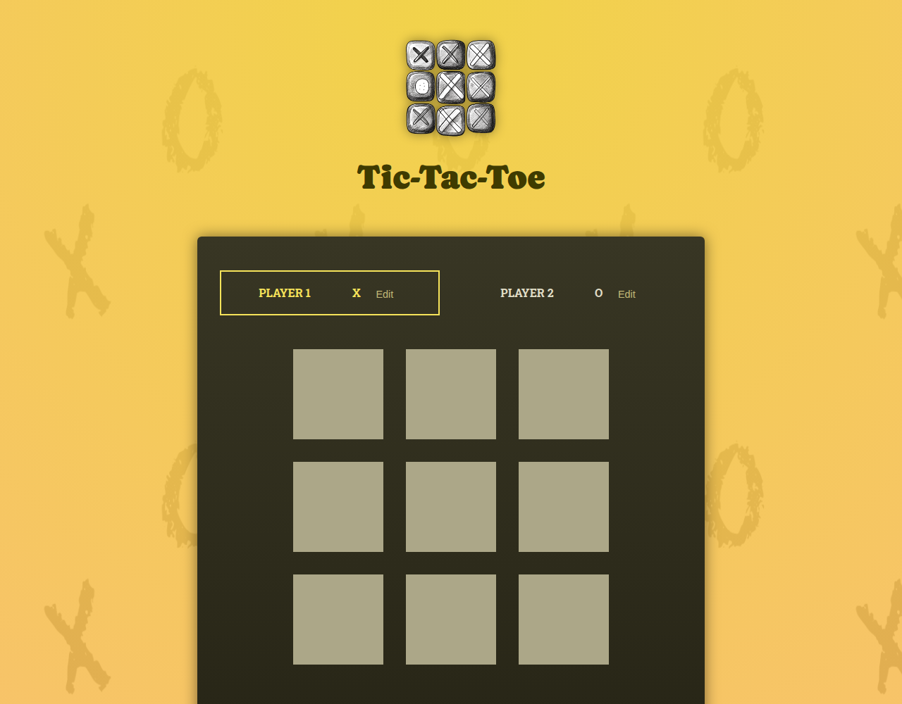

# React Tic-Tac-Toe

A two-player tic-tac-toe game built with **React 19** and **Vite**.

**[▶ Play it live](https://kaligulai.github.io/react-meer-chess/)**



## Features

- Two players take turns on one device (X and O), with the active player highlighted
- Editable player names. The winner is announced by name
- Detection of wins in every row, column and diagonal, and of draws
- Game over screen with a rematch button
- A move log that lists every turn

## How it works

The app keeps as little state as possible and derives everything else from it:

- **`gameTurns`** in [`App.jsx`](src/App.jsx) is the single source of truth: a list of the moves played so far.
- The board, the active player, the winner and the draw state are **computed from `gameTurns` on each render**. They are not stored as separate state, so they can never get out of sync.
- Player names are **lifted up** from `Player` into `App` through an `onChangeName` callback, so the game over screen can show the winner's name.
- State updates that depend on earlier state use the **functional form** of `setState`.

```
src/
├── App.jsx                  # game state and derived values
├── winning_combinations.js  # the 8 winning lines
└── components/
    ├── Player.jsx           # player name with edit mode
    ├── GameBoard.jsx        # 3×3 grid of squares
    ├── GameOver.jsx         # winner / draw overlay with rematch
    └── Log.jsx              # list of moves
```

## Run locally

Requires Node.js 18 or newer.

```bash
git clone https://github.com/Kaligulai/react-meer-chess.git
cd react-meer-chess
npm install
npm run dev
```

Then open the URL that Vite prints (http://localhost:5173/react-meer-chess/).

| Command           | What it does                     |
| ----------------- | -------------------------------- |
| `npm run dev`     | Start the dev server with HMR    |
| `npm run build`   | Build for production into `dist/` |
| `npm run preview` | Serve the production build       |
| `npm run lint`    | Run ESLint                       |

## Deployment

Every push to `main` runs a [GitHub Actions workflow](.github/workflows/deploy.yml). It lints and builds the app, then publishes it to GitHub Pages.
